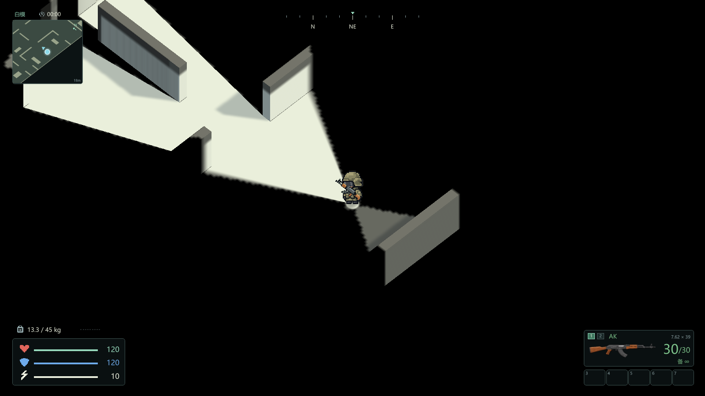

# 灰港行动 · Grey Harbor

使用 Unity 和 C# 制作的俯视角搜刮撤离游戏原型。近未来外星入侵背景下，玩家从前线基地出发，搜集物资、完成任务并撤离。

当前版本：**3.0.47**。包含港口行动、训练与改装试射、营地仓库、交易、制作和 NPC 任务，以及联合转运中心一楼的可探索白模。



## 下载试玩

前往 [Releases](https://github.com/yan450863-ui/grey-harbor/releases) 下载 Windows x64 压缩包，完整解压后运行 `启动游戏.cmd` 或 `Build/GreyHarbor.exe`。运行包自包含，无需安装 Unity。

WASD 移动，Shift 奔跑，Q/E 旋转，M 查看地图，Esc 打开暂停菜单。联合转运中心从「出击 → 联合转运中心 → 进入一楼白模」进入。详细操作与本版范围见 [试玩说明](docs/playtest.md)。

一楼白模为 100×80 米、30 个房间区域，包含墙体遮挡、手电照明和探索记忆；目前没有敌人、搜刮物或撤离点。二楼、地下层及正式场景美术仍待制作。

## 获取源码

安装 Git 和 Git LFS，然后执行：

```sh
git lfs install
git clone https://github.com/yan450863-ui/grey-harbor.git
cd grey-harbor
git lfs pull
```

必要地表资源 `HarborStableGround2721.asset` 约 152 MiB，通过 Git LFS 管理。建议用上述方式获取源码，确保得到真实资源文件。

## 打开与构建

1. 在 Unity Hub 安装 **Unity 6000.6.3f1** 及 Windows Build Support（Mono）。
2. 添加并打开仓库中的 `UnityProject` 文件夹。
3. 打开 `Assets/Scenes/GreyHarbor.unity`，进入 Play 模式；或使用 [构建说明](docs/build.md) 生成 Windows 运行包。

工程使用内置渲染管线、Mono、C# 与 IMGUI。`Assets`、`Packages`、`ProjectSettings` 和所有对应 `.meta` 均保留；`Resources` 和 `StreamingAssets` 是必要依赖。首次导入会重新生成 Unity 缓存。

## 目录

| 路径 | 内容 |
| --- | --- |
| `UnityProject/Assets/Scripts/Runtime` | 玩法、界面、地图及专项验证代码 |
| `UnityProject/Assets/Scripts/Editor` | 构建和资源导出工具 |
| `UnityProject/Assets/Resources` | 运行时加载的图片、地图、材质等 |
| `UnityProject/Assets/StreamingAssets` | 部署图片与必要着色器资源包 |
| `docs` | 构建、试玩、发布范围及验证说明 |
| [PROJECT.md](PROJECT.md) | 当前进度与接手信息 |

## 素材与继续开发

完整公共素材、原图、模型、Unity 导出包、生成记录、着色器制作工程及地图设计已单独打包到 [v3.0.47 Releases](https://github.com/yan450863-ui/grey-harbor/releases/tag/v3.0.47)。下载 `GreyHarbor-3.0.47-Assets-and-Handover.zip`，解压后按 [素材与开发接手指南](docs/handover.md) 使用；包内附文件清单、逐文件 SHA-256 与原图去重索引。

源码文件中的旧版本编号是模块名称，不代表可以删除。部分历史验证依赖旧工程或旧版本号，应按 [验证说明](docs/verification/README.md) 使用。

## 开源范围

项目代码及随仓库提供的项目自有资源采用 [MIT License](LICENSE)。Unity 编辑器、运行时及其依赖组件遵循各自的许可。本项目是独立游戏原型，与《逃离塔科夫》及其开发商无隶属关系。

本仓库发布当前维护工程；完整公共素材与制作档案、Windows 成品包通过 Releases 单独提供。历史游戏版本、个人存档、机器日志及缓存保留在作者本地。详细范围见 [发布整理说明](docs/publication.md)。
